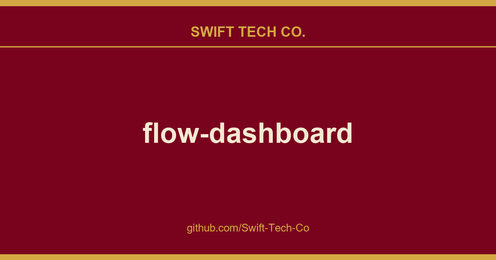

# flow-dashboard

## What This Is

Every project needs a shelf of ready answers. product and engineering is one of those shelves, and flow-dashboard is the entry on it - the notes, patterns and fixes we reuse when this kind of work comes up.

## Images

[](https://github.com/Swift-Tech-Co/flow-dashboard)

## Purpose

Flow is a habit tracker and personal data analytics app that lets you keep focus on what matters. Flow owns none of your data. That's yours.

If you just want look around or get started with Flow, you can create a free account at https://github.com/Swift-Tech-Co/flow-dashboard

To spin up your own instance, or start contributing to this repo, see below.

## API Documentation

The docs are still a work in progress. Check out the current docs at https://github.com/Swift-Tech-Co/flow-dashboard

## Setup

To deploy a new instance of Flow, use the following instructions.
Note that Flow uses the Python 2.7 runtime in GCP, which is now deprecated! 

### Obtain Google App Engine SDK

Download the Cloud SDK from Google.
`https://github.com/Swift-Tech-Co/flow-dashboard

### Setup a new Google Cloud project

Visit the Google developer's console: https://github.com/Swift-Tech-Co/flow-dashboard
Create a new project and choose a unique project ID. You will not need a billing account if usage remains within Google's free tier, which should support low-mid volume use cases.

### Set up a gcloud config

```
gcloud config configurations create [my-flow-config-name]
gcloud config set project [project-id]
gcloud config set account [my email]
```

To activate this configuration: `gcloud config configurations activate [my-flow-config-name]`.

### Fork the repo

Branch or fork this repository into a project directory.

### Setup dependencies

* Node v11.15.0 (recommend using nvm)
* Ensure you have npm and gulp installed.

```
npm install -g gulp
npm install
```

### Update code configuration

Update the APP_OWNER variable in constants.py. Owner should match the Google account you logged into the console with. This will enable the application to send emails.

Create the following files by copying the templates (keep the original template files, which are used when running tests). For this step you'll need to create an oauth 2.0 web client ID from the GCP console, as per the instructions in `secrets_template.py`.

- **secrets.py** ::
	`./settings/secrets_template.py => ./settings/secrets.py`

- **client_secrets.js** ::
	`./src/js/constants/client_secrets.templates.js => ./src/js/constants/clients_secrets.js`

### Run the dev server locally

To avoid conflicts sometimes seen with gcloud and google.cloud python libs it is often helpful to run the dev server in a virtualenv. Make sure dev_appserver.py is in your path.

* `virtualenv env`
* `source env/bin/activate`
* `pip install -t lib -r requirements.txt`
* `pip install -r local.requirements.txt`
* `gcloud components update`
* `cd scripts`
* `./server.sh` (in scripts/) to start the dev server locally.
* Run `gulp` in another terminal to build JS etc
* Visit localhost:8080 to run the app, and localhost:8000 to view the local dev server console.

#### Support for python 2.7 and libraries on M1 Macs

Tested method on M1 Pro as per this SO answer.

```
CONDA_SUBDIR=osx-64 conda create -n py27 python=2.7  # include other packages here

# ensure that future package installs in this env stick to 'osx-64'
conda activate py27
conda config --env --set subdir osx-64
```

### Deploy

* `cd scripts`
* `./deploy.sh 0-1` to deploy a new version 0-1 and set is as default

If you get a permission denied error on a logs directory during deploy, you may need to run the above command wish sudo.

Visit `https://github.com/Swift-Tech-Co/flow-dashboard].appspot.com` to see the app live.

## Features

* Daily journal / survey
	* Configurable questions
	* Optional location pickup & mapping
	* Segment analysis of journals by tag (highlight journal days with/without + show averages)
* Habit tracking ala habits app
	* With weekly targets
	* Commitments
	* Optional daily targets for 'countable' habits
* Tracking top tasks for each day
	* Analyze tasks completed: on time, late, not completed, on each given day
* Monthly/year/long-term goals
	* Goal assessment report at end of month
	* Rating for each goal monthly defined
* Ongoing Projects tracking
	* Track time of each progress increment
	* Link tasks with projects
	* Define labeled milestones
	* View 'burn-up' chart of completion progress over time
* Analysis
	* Show summary charts of all data reported to platform
* Google Assistant / Home / Facebook Messenger integration for actions like:
	* "How am I doing"
	* "What are my goals for this month"
	* "Mark 'run' as complete"
	* "Daily report"
* Reading widget
	* Show currently-reading articles / books
	* Sync quotes from evernote / Kindle
	* Sync articles from Pocket
	* Mark articles / books as favorites, and add notes
	* Quotes & articles fully searchable
* Flash card widget for spreadsheet access (e.g. random quotes, excerpts)
* Export all data to CSV

## Integrations

### Data source integrations

* Public Github commits
* Google Fit - track any activity durations by keyword
* Evernote - pull excerpts from specified notebooks
* Pocket - Sync stored articles & add notes
* Goodreads - Sync currently reading shelf
* Track any abstract data via REST API

### Setup (for separate instance)

All integrations work out of the box on flowdash.co, but if you're spinning up your own instance, you'll need to set up each integration you need.  See below for specific instructions.

#### Pocket

Create an app at https://github.com/Swift-Tech-Co/flow-dashboard and update settings.secrets.POCKET_CONSUMER_KEY

#### Evernote

1. Request an API Key at https://github.com/Swift-Tech-Co/flow-dashboard
2. Request a webhook at https://github.com/Swift-Tech-Co/flow-dashboard pointing to [Your Domain]/api/integrations/evernote/webhook

#### Google Home

We've used API.AI to create an agent that integrates with Google Actions / Assistant / Home. To connect Assistant with a new instance of Flow:

1. Visit https://github.com/Swift-Tech-Co/flow-dashboard
2. Update the agent.json configuration file in static/flow-agent
3. Fill in config params in [Brackets] with your configuration / webhook URLs, etc
4. Import the agent.json to API.AI
5. Go to integrations and add and authorize 'Actions on Google'
6. Preview the integration using the web preview

#### Facebook Messenger

The messenger bot lives at https://github.com/Swift-Tech-Co/flow-dashboard

To create a new messenger bot for your own instance of Flow, see the Facebook quickstart: https://github.com/Swift-Tech-Co/flow-dashboard

#### BigQuery

(Beta / admin only currently) Push daily panel data to BigQuery for additional analysis, e.g. run regressions
with TensorFlow, etc.

## Admin Operations Cheatsheet

### User data deletion

* In console run GQL query
* GQL: `SELECT * WHERE __key__ HAS ANCESTOR KEY(User, [user_id])`
* Delete all entities

## Contributing

Contributions are welcome! See [CONTRIBUTING.md](.github/CONTRIBUTING.md)

## License

MIT License

---

## Swift Tech Co.

Built and maintained by Swift Tech Co.

AI Automation | FinTech Platforms | Custom Software and Mobile Apps | SaaS Platforms | Cloud Infrastructure | Cybersecurity | SEO and Marketing | API Integration

**Join our community on Telegram:** [t.me/+Qt_eFvkb2rliMzNh](https://t.me/+Qt_eFvkb2rliMzNh)

Home | Services | Careers | Referral Program | Influencers | About | Contact

**Connect**

- Website: https://github.com/Swift-Tech-Co/flow-dashboard
- LinkedIn: [linkedin.com/in/stephenoladoke](https://www.linkedin.com/in/stephenoladoke/)
- LinkedIn (Company): [linkedin.com/company/swift-tech-co](https://www.linkedin.com/company/swift-tech-co)
- X: [@MrOladoke](https://x.com/MrOladoke)
- Instagram: [@mr.oladoke](https://www.instagram.com/mr.oladoke/)
- Instagram (Company): [@swifttechco](https://www.instagram.com/swifttechco/)
- Organization: [github.com/Swift-Tech-Co](https://github.com/Swift-Tech-Co)

## Sources

Compiled and maintained from upstream [onejgordon/flow-dashboard](https://github.com/onejgordon/flow-dashboard) under permissive open-source license.

---

Maintained by [Swift Tech Co.](https://github.com/Swift-Tech-Co) - [Telegram](https://t.me/+Qt_eFvkb2rliMzNh)

## Sources

Compiled and maintained from upstream [onejgordon/flow-dashboard](https://github.com/onejgordon/flow-dashboard) under permissive open-source license.

---

Maintained by [Swift Tech Co.](https://github.com/Swift-Tech-Co) - [Telegram](https://t.me/+Qt_eFvkb2rliMzNh)